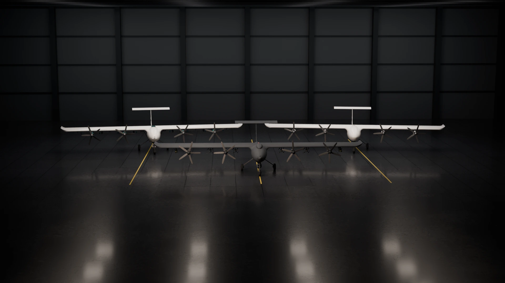
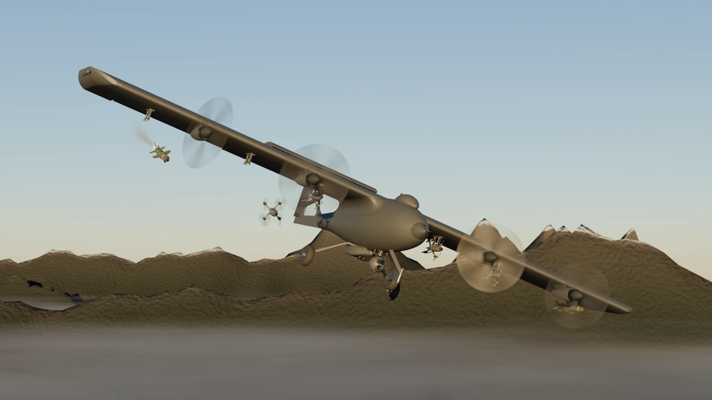
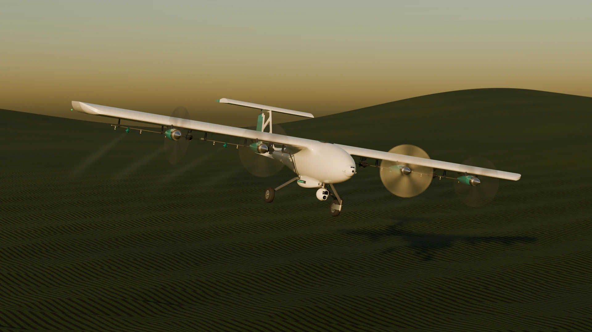
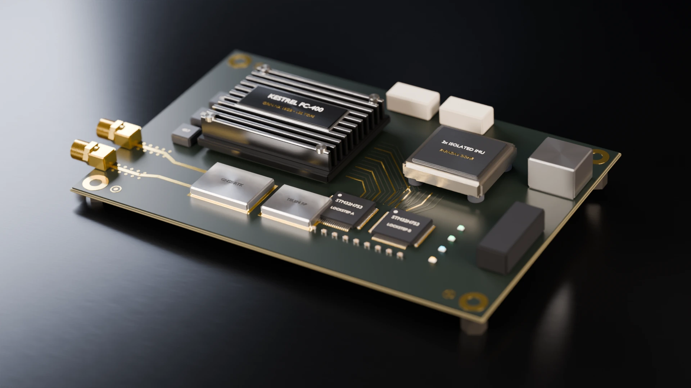

# KESTREL AEROSPACE — Sovereign Autonomous Air Systems

**Canlı Platform (GitHub Pages):** [https://huzarh.github.io/kestrel-aerospace/](https://huzarh.github.io/kestrel-aerospace/)

Tek bir **11.006 mm otoklav 3K karbon-prepreg ortak hava aracı gövdesi**, özgün **Kestrel FC-400 (KST-FC-400-REV-C)** üçlü yedekli uçuş/yapay zekâ bilgisayarı ve **Q-Lock MP-60 (KST-QL-060-REV-B)** kör-eşleşmeli titanyum pilon kaplinleri üzerinde üç bağımsız görev divizyonunu birleştiren dikey entegre otonom havacılık platformu.

---

## Görev Divizyonları / Mission Divisions

| Kod | Platform | Görev Alanı | Doğrulanmış Temel Donanım & Performans |
| :--- | :--- | :--- | :--- |
| **KST-S1** | **Kestrel S1** | Aktif 3B LiDAR & Jeodezik Haritalama | 1024×32 kanal aktif LiDAR (`327.680 nokta/sn`), `123,2°` nadir RGB kamera, `≤ 2,9 mm` Z-kalibrasyon doğruluğu |
| **KST-B2** | **Kestrel B2** | 300 L Otonom Tarım & Optik Lazer | `635 kg` MTOW, `300 L` karın tankı, `20 m` EPA AgDRIFT® şerit (`105 ha/saat`), `8×` dinamik-VMD döner atomizer, `4× 320 W` 2-eksen lazer tareti, `90 kWh` hızlı değişim batarya |
| **KST-A2** | **Kestrel A2** | Düşük Görünürlüklü C4ISR & Sürü Taşıyıcı SİHA | Konformal `300 m` X-Bant AESA radar, Ku-Bant BLOS SATCOM, karın altı DRFM EH + ALE-47, STANAG 1688 lazer işaretleyici, `4× 52 m/s` 3B-PN önleyici İHA + `2× MAM-L` SALH mühimmat |

### Kestrel A2 — Yüksek İrtifa C4ISR, Sürü Önleme & MAM-L Hava-Yer Taarruz Sortisi

### Kestrel B2 — Alacakaranlık Hassas Sıvı İlaçlama & Optik Fitopatoloji

### Kestrel FC-400 — Üçlü Yedekli Uçuş Kontrol & 100 TOPS Görev Bilgisayarı (`148 × 96 mm`)

---

## Mühendislik ve Web Mimarisi (Sıfır Kurgusal Veri)
- **9 Fotogerçekçi Blender 4.2 Cycles OptiX Render (`renders/*.webp`):** Doğrudan üretim CAD (`build123d`/`STEP`) ve simülasyon (`SDF`) geometrisinden `AgX` renk uzayında üretilmiştir.
- **Gerçek Zamanlı Three.js WebGL 3B CAD İnceleyici (`models/*.glb`):** `S1`, `B2`, `A2`, `FC-400 PCB` ve `Q-Lock MP-60` çok-malzemeli modellerini tarayıcıda canlı inceleme.
- **CAD Çekirdeğinden Üretilmiş ISO A3 İmalat Teknik Resimleri (`blueprints/*.pdf`):** `KST-FC-400-REV-C`, `KST-QL-060-REV-B` ve `KST-A2-RAD-01` üçüncü bölge ortografik imalat paftaları.
- **Canlı İzometrik HIL Kabul Tezgâhı (`assets/hil_rig_anatomy.js`):** Q-Lock pilon kilidi ve kontrol yüzeyi tork dinamometresi etkileşimli simülasyonu.
- **Çift Dilli (`TR` / `EN`) 8 Tam Sayfa Mimari:** `/`, `/platforms/s1`, `/platforms/b2`, `/platforms/a2`, `/avionics`, `/manufacturing`, `/research`, `/configure`.
